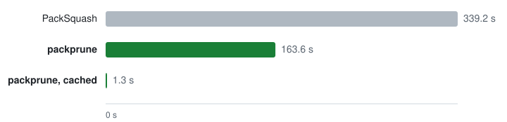

<p align="center">
  
</p>

<h1 align="center">packprune</h1>

<p align="center">
  Smaller Minecraft Java resource packs. Players see and hear the same pack.
</p>

<p align="center">
  <a href="https://github.com/mediavee/packprune/actions/workflows/ci.yml"></a>
  <a href="LICENSE"></a>
  
</p>

<p align="center">
  <picture>
    <source media="(prefers-color-scheme: dark)" srcset="docs/assets/bench-dark.svg">
    
  </picture>
</p>

<p align="center"><i>Faithful 32x, lossless, both tools at their strongest settings (<a href="docs/benchmarks.md">benchmarks</a>).</i></p>

- **Prunes what nothing uses.** It follows every reference the client resolves, and reads your server's plugins
  (Nexo, plugin configs, data packs) for the resources only the server names. Up to **28 % smaller** than
  PackSquash on real server packs.
- **Proves every lossless change.** Each file is decoded the way the client decodes it and compared; one
  difference stops the run.
- **Fast.** Up to **3× faster** than PackSquash on a first run; a lossless rerun on an unchanged pack takes 1 to 9 s.
- **Lossy only where you ask**, with quality thresholds: PNG quantisation, downscaling, Vorbis transcoding.
- **Reproducible.** Same input, same zip, byte for byte, whatever the thread count.
- **Drop-in for PackSquash** in Nexo.

## Install

Download a binary for Linux, macOS or Windows from the [releases](https://github.com/mediavee/packprune/releases)
([checksums](docs/install.md)), or build it with Rust 1.99 or later:

```sh
cargo install --locked --git https://github.com/mediavee/packprune packprune-cli
```

## Quick start

```sh
packprune optimise ./pack -o pack.zip --client-jar client-26.2.jar
packprune check ./pack --client-jar client-26.2.jar         # missing references, orphans, budgets
packprune diff ./pack pack.zip --client-jar client-26.2.jar # what changes for the player
```

The pack is a folder or a zip; `--client-jar` is the vanilla client jar of its Minecraft version. Lossy passes,
server sources and budgets go in a [`packprune.toml`](docs/configuration.md). Running Nexo? Swap PackSquash out
in [three steps](docs/nexo.md).

## Results

Zip size against PackSquash 0.4.1, both tools at their strongest settings: a conformant zip without loss, each
tool's smallest zip layout with loss.

| Pack | Input | PackSquash | packprune | PackSquash lossy | packprune lossy |
|---|---:|---:|---:|---:|---:|
| Server pack A | 14.79 MB | 11.72 MB | **8.47 MB** | 9.17 MB | **7.00 MB** |
| Server pack B | 7.78 MB | 5.83 MB | **4.93 MB** | 5.12 MB | **4.28 MB** |
| Faithful 32x | 13.12 MB | 8.02 MB | **8.01 MB** | 5.08 MB | **4.78 MB** |
| Faithful 64x | 19.41 MB | fails | **13.80 MB** | fails | **8.26 MB** |
| Guns++ | 25.57 MB | 6.71 MB | **6.49 MB** | fails | **4.54 MB** |
| CTM Overhaul | 40.81 MB | **0.487 MB** | 0.488 MB | 0.45 MB | **0.38 MB** |
| Enhanced Audio | 18.98 MB | **17.21 MB** | 17.22 MB | **8.76 MB** | 9.83 MB |

Server packs are Nexo packs pruned with their server's plugin folder; the others are public packs, where nothing
outside the pack names a resource. Times, method and reproduction: [benchmarks](docs/benchmarks.md).

## For scripts and agents

- `packprune <command> --help` documents every flag; `packprune schema` prints the JSON schema of `packprune.toml`.
- Exit codes: `0` success, `1` findings or a budget exceeded, `2` input or config refused, `3` processing failure.
- `optimise` writes `<output>.report/`: `report.json` (orphans, missing references, warnings), `passes.json`
  (what each pass changed, measured loss) and `run.json` (output, removals by reason, costs). Read them rather
  than the logs.
- `--expect-report report.json` refuses a run whose inputs or removals differ from a report you reviewed.

## Documentation

- [Install](docs/install.md): release assets, checksums, the CLI.
- [Nexo](docs/nexo.md): replace PackSquash, failure behaviour, the `lean` zip layout.
- [Configuration](docs/configuration.md): profiles, lossy passes, server sources, reports.
- [Benchmarks](docs/benchmarks.md): method, full tables, how to reproduce.
- [Architecture](docs/architecture.md): crates, the pipeline, every pass.

## Contributing

`scripts/check` runs the same gate as CI; it needs `cargo-deny`, `unzip` and Perl. See [AGENTS.md](AGENTS.md).

## License

[GPL-3.0-or-later](LICENSE). Vendored crates in `vendor/` keep their own licences; release binaries ship with
`THIRD-PARTY-LICENSES.txt`.
